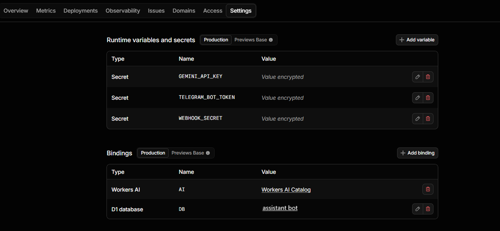
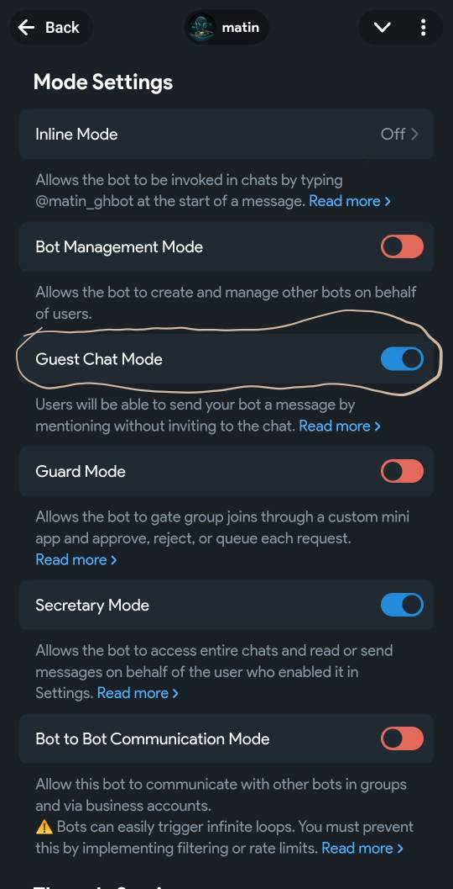

# راه‌اندازی از داشبورد Cloudflare

این پروژه با ویرایشگر داشبورد قابل استقرار است و به نصب Wrangler یا فایل `wrangler.toml` نیاز ندارد. ساختار D1 را در کنسول داشبورد اجرا کنید و کدها را به‌صورت سه ماژول جداگانه وارد کنید. توکن و کلیدها را در تنظیمات Worker به‌صورت Secret ثبت کنید.

## ۱. ساخت Worker

در Cloudflare به **Workers & Pages** بروید، یک Worker بسازید و آن را Deploy کنید. سپس صفحهٔ همان Worker را باز کنید و **Edit code** را انتخاب کنید.

## ۲. بارگذاری ماژول‌های کد

در ویرایشگر، سه فایل جاوااسکریپت پروژه را به‌عنوان ماژول اضافه کنید:

- `worker.js` — ماژول اصلی که `export default` دارد.
- `config.js`
- `prompts.js`

محتوای هر فایل را در ماژول هم‌نام قرار دهید تا importهای نسبی داخل `worker.js` کار کنند. سپس **Deploy** را بزنید.

## ۳. ساخت و آماده‌سازی D1

از بخش **Storage & Databases > D1 SQL Database** یک پایگاه‌داده بسازید. وارد صفحهٔ همان D1 و کنسول SQL شوید، محتوای `schema.sql` را اجرا کنید.

## ۴. افزودن Bindingها

در صفحهٔ Worker به **Settings > Bindings** بروید و این دو Binding را بسازید:

| نوع Binding | Variable name | منبع |
|---|---|---|
| D1 database | `DB` | پایگاه‌داده‌ای که در مرحلهٔ قبل ساختید |
| Workers AI | `AI` | Workers AI |

نام متغیرها باید دقیقاً `DB` و `AI` باشد؛ کد همین نام‌ها را از محیط Worker می‌خواند.



در تصویر، سه Secret و دو Binding لازم (`AI` و `DB`) دیده می‌شوند. مقدار Secretها رمزگذاری‌شده است و نمایش داده نمی‌شود. `ADMIN_CHAT_IDS` یک Variable جداگانه است و در مرحلهٔ بعد تنظیم می‌شود.

## ۵. تنظیم کلیدها و شناسهٔ مالک

اگر هنوز بات تلگرام نساخته‌ای، در تلگرام به **@BotFather** پیام بده، `/newbot` را بفرست و مراحل ساخت را دنبال کن؛ BotFather توکن را در پایان می‌دهد. اگر بات از قبل داری، از `/mybots` آن را انتخاب کن. در صورت گم‌شدن یا افشای توکن، `/token` را برای همان بات اجرا کن تا توکن تازه بگیری؛ توکن تازه را محرمانه نگه دار.

در **Settings > Variables and Secrets**، سه مقدار زیر را از نوع **Secret** بسازید:

- `TELEGRAM_BOT_TOKEN`: توکن بات از BotFather.
- `GEMINI_API_KEY`: کلید Gemini؛ برای PDF، استخراج اطلاعات از عکس و مسیر اصلی تبدیل صوت لازم است. اگر برای صوت تنظیم نشود، بات در صورت فعال بودن Workers AI می‌تواند از Whisper به‌عنوان جایگزین استفاده کند.
- `WEBHOOK_SECRET`: رشتهٔ تصادفی قوی برای بررسی درخواست‌های Webhook.

یک Variable به نام `ADMIN_CHAT_IDS` هم اضافه کنید و شناسهٔ عددی مالک یا مالک‌ها را با کاما جدا کنید؛ مثلاً `123456789,987654321`. بدون شناسهٔ معتبر، هیچ فرمانی اجرا نمی‌شود؛ پیام خصوصی راهنمای تنظیم می‌گیرد و درخواست Guest بی‌پاسخ می‌ماند.

کلیدهای محرمانه در `config.js` تعریف نشده‌اند و فقط از Secretهای داشبورد خوانده می‌شوند. بدون این Secretها Webhook و قابلیت‌های وابسته به Gemini کار نمی‌کنند؛ کلیدها را داخل سورس ننویسید و تصویر یا فایل حاوی مقدار آن‌ها را منتشر نکنید.

تنظیمات اختیاری زیر را هم می‌توان بدون ویرایش کد با Variable هم‌نام عوض کرد؛ اگر تعریف نشوند، مقدار `config.js` استفاده می‌شود:

| متغیر | کاربرد | پیش‌فرض |
|---|---|---|
| `DEBUG` | جزئیات خطا در پاسخ‌ها و لاگ‌ها | خاموش (`0`) |
| `SUMMARY_LANG` | زبان خلاصه‌های متن، لینک و PDF | `Persian` |
| `LANG` | زبان پیشنهادی برای Whisper | `fa` |
| `GEMINI_MODELS` | مدل‌های Gemini به ترتیب تلاش، جداشده با کاما | مقدارهای `config.js` |
| `AUTO_TRANSCRIBE_DIRECT_VOICE` | تبدیل ویس مستقیم، بدون فرمان `/stt` | خاموش |
| `STT_MEDIA` | نوع رسانه‌های قابل‌قبول برای `/stt`، جداشده با کاما | `voice` |
| `ASK_THREAD_DAYS` | مدت نگهداری تاریخچهٔ ادامهٔ `/ask` | ۷ روز |

فقط کلیدهای داخل شیء `CONFIG` (مثل `LLM_MODEL`، `LLM_TIMEOUT_SEC`، `GEMINI_TIMEOUT_SEC`، `STT_TOTAL_SEC` و `TEXT_MAX_INPUT`) را می‌توان با Variable هم‌نام عوض کرد. ثابت‌های دیگر `config.js` (مثل `MAX_TEXT`، `CHUNK_CHARS`، `MAX_REMINDERS` و `MAX_FILE_BYTES`) مستقیم در کد import می‌شوند و فقط با ویرایش `config.js` و Deploy دوباره تغییر می‌کنند.

## ۶. افزودن Cron برای یادآوری

در **Settings > Triggers > Cron Triggers** یک Trigger با عبارت زیر اضافه کنید:

```text
* * * * *
```

تابع `scheduled` Worker هر دقیقه یادآوری‌های سررسیدشده را بررسی می‌کند. Triggerهای داشبورد بر اساس UTC زمان‌بندی می‌شوند؛ کد، زمان یادآوری کاربر را بر اساس ساعت تهران محاسبه می‌کند.

## ۷. ثبت Telegram Webhook

پس از Deploy، نشانی `workers.dev` مربوط به Worker را کپی کنید. درخواست زیر را اجرا کنید؛ `<TELEGRAM_BOT_TOKEN>` و `<WEBHOOK_SECRET>` را با مقدار Secretهای ثبت‌شده در تنظیمات Worker جایگزین کنید:

```sh
curl -X POST "https://api.telegram.org/bot<TELEGRAM_BOT_TOKEN>/setWebhook" \
  -H "Content-Type: application/json" \
  -d '{"url":"https://<WORKER_NAME>.<SUBDOMAIN>.workers.dev","secret_token":"<WEBHOOK_SECRET>","allowed_updates":["message","guest_message","callback_query"]}'
```

مقدار `secret_token` باید دقیقاً با Secret به نام `WEBHOOK_SECRET` در تنظیمات Worker یکی باشد. اگر آدرس Worker یا راز عوض شد، Webhook را دوباره ثبت کنید.

اگر Webhook را قبلاً ثبت کرده‌اید، این درخواست را دوباره اجرا کنید تا فهرست `allowed_updates` به‌روز شود؛ تلگرام در صورت حذف این پارامتر می‌تواند فهرست قبلی را نگه دارد. این فهرست پیام خصوصی، پیام Guest و callback دکمه‌های یادآور را فعال می‌کند. برای جزئیات، [مستند setWebhook تلگرام](https://core.telegram.org/bots/api#setwebhook) را ببینید.

## ۸. روشن‌کردن Guest Mode در تلگرام

در تلگرام، مینی‌اپ رسمی **@BotFather** را باز کنید، بات موردنظر را انتخاب کنید و در **Mode Settings** گزینهٔ **Guest Chat Mode** را روشن کنید. تصویر زیر محل این گزینه را نشان می‌دهد؛ برای این پروژه لازم نیست گزینه‌های دیگر صفحه را تغییر دهید. طبق [مستند رسمی تلگرام](https://core.telegram.org/bots/features#guest-bots)، این قابلیت از تنظیمات BotFather Mini App فعال می‌شود.



پس از روشن‌کردن آن، می‌توان بات را در چت پشتیبانی‌شده با `@نام‌بات فرمان` صدا زد؛ برای پردازش پیام مشخص، روی همان پیام ریپلای کنید. بات لازم نیست عضو گروه باشد. این پروژه همچنان فقط به افرادی پاسخ می‌دهد که شناسه‌شان در `ADMIN_CHAT_IDS` است؛ برای دیگران بی‌صدا می‌ماند. Guest Mode به تاریخچهٔ کامل چت دسترسی نمی‌دهد و فقط پیام فراخوانی و زمینهٔ ریپلای‌شده را می‌گیرد. در گروه‌هایی که محافظت محتوا روشن است نیز Guest Mode قابل استفاده نیست.

## محدودیت‌ها، داده و امنیت

- دریافت فایل از تلگرام به ۲۰ مگابایت محدود است؛ فایل‌های PDF ارسالی و PDFهای لینک‌شده حداکثر ۱۴ مگابایت‌اند. صوت بزرگ‌تر از سقف ورودی Gemini ممکن است به Whisper سپرده شود.
- عکس برای `/extract` به Gemini فرستاده می‌شود؛ سقف ورودی تصویر ۱۴ مگابایت است.
- از صفحهٔ وب حداکثر ۳ مگابایت خوانده می‌شود و متن ارسالی به مدل حداکثر ۱۲٬۰۰۰ نویسه است.
- حداکثر ۵۰ یادآوری فعال برای هر کاربر پذیرفته می‌شود و زمان یادآوری بیشتر از حدود یک سال پشتیبانی نمی‌شود.
- D1 شناسهٔ آپدیت‌های اخیر، تاریخچهٔ `/ask` و یادآوری‌های فعال را نگه می‌دارد. تاریخچهٔ `/ask` بعد از ۷ روز پاک می‌شود.
- مدل‌های Gemini و Workers AI متن یا فایل لازم برای انجام فرمان را دریافت می‌کنند.
- خلاصه‌سازی لینک فقط HTTP و HTTPS روی درگاه‌های استاندارد را می‌پذیرد. نشانی IP و مقصدهای غیرعمومی رد می‌شوند و مقصد هر redirect جداگانه بررسی می‌شود.
- توکن و کلیدها در تنظیمات Worker به‌صورت Secret ذخیره می‌شوند؛ آن‌ها را داخل سورس ننویسید یا در تصویر و پیام منتشر نکنید. در محیط واقعی `DEBUG` را خاموش نگه دارید؛ آپدیت‌های خام تلگرام ممکن است محتوای پیام دیگران را داشته باشند.
- اگر یکی از Secretها جایی فاش شد، آن را عوض کنید: توکن بات از BotFather (`/revoke` یا `/token`)، کلید Gemini از Google AI Studio، و `WEBHOOK_SECRET` را با مقدار تازه همراه با ثبت دوبارهٔ Webhook. پاک‌کردن مقدار از تنظیمات به‌تنهایی آن را باطل نمی‌کند.

## ۹. بررسی راه‌اندازی

- در گفتگوی خصوصی با بات `/start` و `/help` را بفرستید.
- یک ویس بفرستید و روی آن `/stt` را اجرا کنید.
- روی یک پیام متنی `/sum` یا `/tr english` را امتحان کنید.
- پس از روشن‌کردن Guest Chat Mode، در یک چت دیگر `@نام‌بات sum` را امتحان کنید؛ بات باید همان‌جا پاسخ بدهد.
- `/remind ۲ دقیقه دیگه بررسی` را امتحان کنید؛ یادآوری با اجرای Cron بعدی ارسال می‌شود.
- اگر خطایی رخ داد، لاگ Worker را از داشبورد بررسی کنید. `DEBUG` به‌طور پیش‌فرض خاموش است.

## عیب‌یابی

- اگر نشانی Worker را در مرورگر باز کردید و خطای `ADMIN_CHAT_IDS` دیدید، شناسهٔ عددی تلگرام مالک را در Variable همنام در تنظیمات Worker وارد کنید؛ تا آن زمان پیام خصوصی راهنمای تنظیم می‌گیرد و پیام‌های Guest بی‌پاسخ می‌مانند.
- پاسخ `403 forbidden` معمولاً یعنی `secret_token` ثبت‌شده در تلگرام با Secret `WEBHOOK_SECRET` در تنظیمات Worker یکی نیست.
- خطای D1 را با وجود Binding به نام `DB` و اجرای کامل `schema.sql` بررسی کنید.
- اگر یادآوری ثبت می‌شود ولی نمی‌رسد، Cron Trigger دقیقه‌ای و Binding `DB` را بررسی کنید.
- اگر قابلیت‌های متنی کار نمی‌کنند، Binding `AI` و دسترسی Workers AI را بررسی کنید. PDF و استخراج از عکس به `GEMINI_API_KEY` نیاز دارند؛ تبدیل صوت می‌تواند در صورت نبود آن از Whisper در Workers AI کمک بگیرد.
